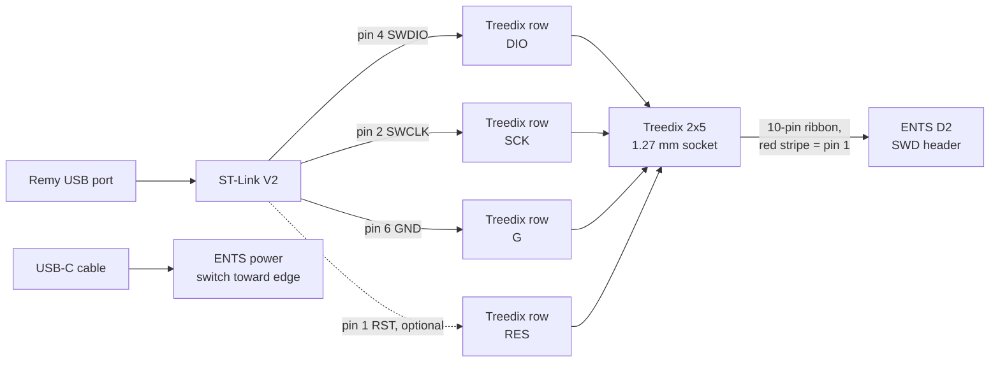
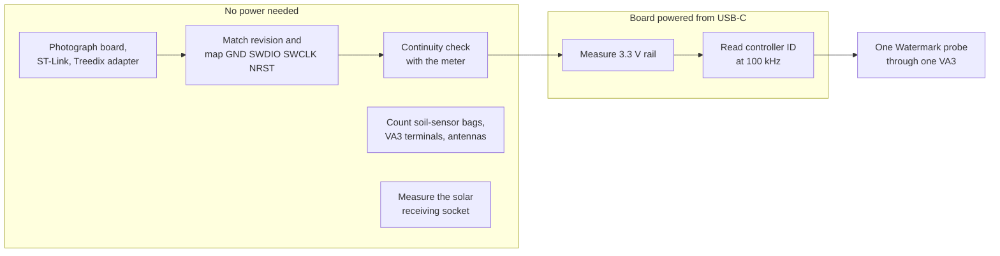

# Bench log

Status: working
Owner: Nicholas Melnichenko
Updated: 2026-10-26
Evidence: dated local build checkpoints, the October 2026 accessory delivery readback, and Nicholas's bench reports

**Next test: identify one ENTS board and read a valid controller ID.** An October 26 attempt with Luis got no signal. Photos taken the same day show a likely cause: the Treedix breakout's pin row was never soldered, so the jumpers had no reliable contact. Wire to the Treedix 20-pin box header instead, which is already fitted. Nothing has been powered and measured with a saved result yet. There is no saved controller ID, soil reading, or radio packet. The last recorded SWD attempt returned `0x000` with `ENTER_SWD error (0x09)`.

## Wiring map from the October 26 photos

The step-by-step version without project history is [ENTS 3.1.0 programming setup](ents-programming-setup.md). It uses the Treedix 20-pin box header, so no soldering is needed.

The photographed board is **ENTS node 3.1.0, unit `3.1.0-046`**. Each link below is read from a photo in the [parts photo atlas](../03-hardware/parts-atlas.md). The ENTS firmware setup guide places the `D2` SWD header near the `J4` three-position SDI-12 screw terminal; confirm it on the board front, which has not been photographed yet.

| ST-Link V2 pin | Signal | Treedix row hole | Notes |
|---|---|---|---|
| 4 | SWDIO | DIO (2nd from square pad) | required |
| 2 | SWCLK | SCK (3rd) | required |
| 6 (or 5) | GND | G (4th, 5th or 8th) | required |
| 1 | RST | RES (7th) | only for connect-under-reset |
| 7 to 10 | 3.3 V, 5.0 V | V | leave unconnected; the board runs from USB-C |

The Treedix row reads, from the square pad: V, DIO, SCK, G, G, SWO, RES, G, NC, V.

1. **Use the fitted 20-pin box header, not the bare row:** ST-Link pin 4 to header pin 7, pin 2 to pin 9, pin 6 to pin 4, and optionally pin 1 to pin 15. Beep-test each wire against the labelled row hole in the table. Soldering a strip into the row is the fallback.
2. Confirm the four wires. Plug the 10-pin ribbon into the Treedix 2x5 socket and the ENTS `D2` header with the red stripe on pin 1 at both ends.
3. Power the ENTS board from USB-C, switch toward the board edge, and measure the 3.3 V rail.
4. Connect at low speed (`st-info --probe --hot-plug --freq=100`, or STM32CubeProgrammer). If it fails, hold the board's RESET button, click Connect, then release.

**A new board can report `Error: data read failed`.** The ENTS setup guide says this is expected: the factory firmware is read-protected, and the connection is working. Its next step removes read protection, which erases the factory firmware. Record the controller ID and output first, and treat the erase as a separate, deliberate step.

## With no power supply on hand

Most of the first check needs no power. The ENTS board's documented bench supply is its USB-C port, so a laptop and a USB-C cable are enough for steps 3 and 4 below; the solar panels and their plug adapter are only needed in the field. Photos of each part are in the [parts photo atlas](../03-hardware/parts-atlas.md).

1. **Identify and map.** Photograph both board faces, the revision text, the ST-Link pin labels and both faces of the Treedix adapter. Record where each signal lands at all three.
2. **Check continuity.** Trace GND, SWDIO, SWCLK and NRST end to end with the meter. Check that power is not shorted to ground.
3. **Count the small parts.** Record what is inside each soil-sensor bag (probes, temperature probes, VA3 adapters, leads), the VA3 terminal labels, and the antenna connectors' center contacts.
4. **Measure the solar receiving socket.** The panel plug is 3.5 x 1.1 mm. Record the socket's outer and pin diameter and its polarity before buying an adapter.

When a USB-C supply is available, continue with steps 3 and 4 of the first check.

## Two separate paths

The **programming path** lets the computer talk to the controller. It runs from the ST-Link through jumper leads and the 1.27 mm adapter and ribbon to the board's small programming header. The **sensor path** turns a Watermark probe's resistance into a voltage the controller reads. It runs from one 200SS probe through the 200SS-VA3 adapter to one confirmed ENTS analog input. The small ribbon is not a soil-sensor cable.

## First check: the controller

Allow 60 to 90 minutes. Keep the battery, solar panel, sensors, and valve disconnected throughout.

1. **Lay out and photograph.** One ENTS board, the ST-Link, the 1.27 mm adapter kit, jumper leads, a USB cable, and a multimeter. Photograph both board faces, the revision text, the programming header, the ST-Link pin labels, and both faces of the adapter. Result: readable markings, not a shopping list.
2. **Match the revision and map the signals.** Find the schematic for the photographed revision. Record where `GND`, `SWDIO`, `SWCLK`, and `NRST` land at the ST-Link, the adapter, and the board. A red stripe or a keyed plug is not an electrical map. With power off, confirm each path in continuity mode and check that power is not shorted to ground. Result: a recorded signal map and continuity results.
3. **Power from one source and measure.** Use the board's USB input as the only supply. Measure the controller rail against its ground. Leave the ST-Link's 3.3 V and 5 V outputs disconnected. Result: measured rail voltage, correct polarity, one supply.
4. **Read the target ID.** Use one debugger with the recorded wiring. Save the tool, host, command, output, and a wiring photo. A supported target ID finishes this check. If the result is `0x000` again, recheck power, continuity, and reset before repeating. Do not flash, erase, or change protection to diagnose an unidentified connection.

| Signal | Purpose | Record before connecting |
|---|---|---|
| `GND` | shared reference | contacts at ST-Link, adapter, and board; continuity |
| `SWDIO` | debug data | contacts at all three ends; continuity |
| `SWCLK` | debug clock | contacts at all three ends; continuity |
| `NRST` | controller reset, if used | probe output and board reset contact |
| 3.3 V / 5 V probe outputs | optional probe-supplied power | leave disconnected while the board is USB-powered |

The numbered header contacts stay unresolved until the board and adapter are matched. The upstream ENTS hardware README names two different connectors `J9`, so it cannot identify a socket on the received board by itself. Earlier local notes gave conflicting D1 and D2 advice; they are historical evidence, not a wiring map.

## Second check: one soil path

Allow 60 to 120 minutes after the controller check, if the matching firmware already exists.

1. Identify the VA3 model and terminal labels against Irrometer sheet 427. Connect one 200SS probe's two wires to the labelled sensor-input pair with power off.
2. With the ENTS inputs still disconnected, supply the VA3 from a verified regulated source and measure its output against the labelled reference. The sheet gives a 3 to 30 V supply, a 0 to 2.8 V output, a 500 ms startup, and roughly five-minute updates under continuous power.
3. Confirm the ENTS input conditioning, common reference, and firmware conversion before joining that output. Save the raw count, the engineering value, the time, and a known physical response. A voltage alone is not a calibrated moisture reading.
4. Only then expand to the other VA3 channels. The ADS1115 waits for the channel map.

## Session record

| Date | What happened | Result |
|---|---|---|
| 2026-09-25 | First bench attempt on the other laptop with female-to-female leads. | Debugger and serial attempts failed. No controller ID. |
| 2026-10-01 to 10-02 | Parts arrival review. Nicholas reported the solar adapter, batteries, and resistors in hand. | Inventory reconciled; no hardware test. |
| 2026-10-13 | Document and receipt review after Nicholas reported the parts arrived and the connections were confusing. | First-check procedure written. No hardware connected. |
| 2026-10-26 | Bench handed to Luis. No power supply on hand for the solar path. Eleven close-up photos taken. | No signal. Photos identify board 3.1.0-046, the ST-Link pinout, and an unsoldered Treedix pin row as the likely cause. Wiring map added. |
| 2026-10-22 to 10-23 | Order reconciliation and workspace recovery. All seven accessory lines confirmed delivered. Gateway present, original antenna missing. Meter and jumper leads confirmed missing and selected for purchase. Older `pending` rows found superseded by later order summaries. | Checkpoint saved; the next test is unchanged. |

## What is still unknown

| Owner | Missing evidence | What it unlocks |
|---|---|---|
| Nicholas and Luis | what "no signal" meant on October 26: no USB device, probe found but no target, or no serial output |  the failed link to recheck first |
| Nicholas | ENTS board front (D2 location and pin 1), continuity after soldering, rail voltage | a valid controller ID |
| Nicholas | antenna center contacts against the gateway and node sockets | which antenna pack fits where |
| Nicholas | ENTS solar socket diameter (center positive and 18 V maximum are printed on the board) | the solar plug adapter purchase |
| Nicholas | counts inside the three soil-sensor bags and the remaining panels | exact shortages without duplicate orders |
| purchasing owner | receiving readback for the HOBO gateway, Signalizer, and panels | delivery questions closed or the order investigated |
| Nicholas and station owner | Davis transmitter and receiver region; valve coil and supply | the receiver choice and a compatible valve design |

Continue with the [assembly and test plan](assembly-and-test.md) once the controller and one soil path are proved.
