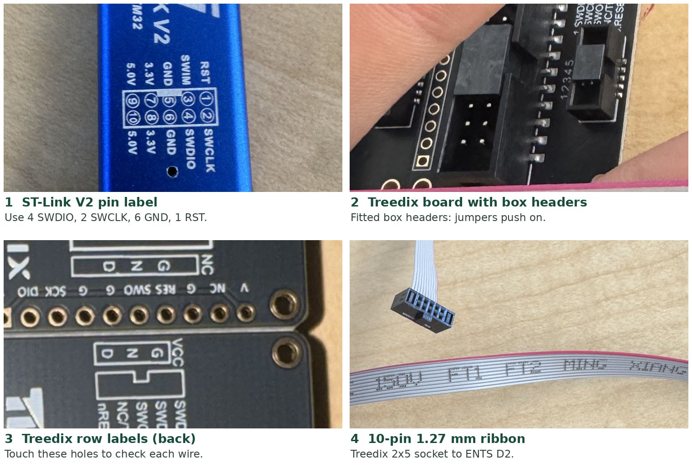

# ENTS 3.1.0 bench setup: programming connection

Status: working
Owner: Nicholas Melnichenko
Updated: 2026-10-26
Evidence: October 26, 2026 photos of the ST-Link V2, Treedix adapter, ribbon and ENTS 3.1.0-046 board; ENTS firmware setup guide

These steps connect a computer to the controller on one ENTS node and read its ID. You need a laptop, but no solar panel or battery. Do every wiring step with all power disconnected.

## What you need

| Part | Notes |
| --- | --- |
| ENTS node 3.1.0 | The version is on the white label on the back, for example `3.1.0-046` |
| ST-Link V2 programmer | Blue USB stick with a 10-pin header |
| Treedix SWD adapter | Black board with a 20-pin box header and a small 2x5 socket |
| 10-pin 1.27 mm ribbon | Thin grey ribbon with a red stripe |
| 4 female-to-female jumper wires | 2.54 mm (0.1 inch) ends |
| USB-C cable | Powers the ENTS board from the laptop |
| Multimeter | Continuity (beep) mode and DC volts |
| Laptop with STM32CubeProgrammer | Free from st.com; `st-info` also works |

## Three rules

1. **Never connect the ST-Link's 3.3 V or 5.0 V pins** (7 to 10). The board gets its power from USB-C only.
2. **Change wires only with both USB cables unplugged.**
3. **Do not erase, flash or change protection settings.** These steps only read the controller ID.

## The parts

*The programming parts. Photo 3 shows the labelled holes used for checking each wire.*

**Photo 1:** the ST-Link pin numbers are printed beside its header. **Photo 2:** the Treedix board with its box headers already fitted. **Photo 3:** the labelled holes on the Treedix edge row, used for checking each wire. **Photo 4:** the 10-pin ribbon; the red stripe marks pin 1.

## Step 1: Wire the ST-Link to the Treedix board

Laptop USB → ST-Link V2 → 4 jumper wires → Treedix 20-pin box header → Treedix 2x5 socket → 10-pin ribbon → ENTS D2 header. The ENTS board is powered by its own USB-C cable.

**No soldering is needed.** Push the jumpers onto the pins inside the Treedix's black 20-pin box header. Find pin 1 from the triangle or "1" mark beside the header. Odd pins (1, 3, 5 …) run along one row and even pins along the other.

| ST-Link V2 pin | Signal | Treedix 20-pin header | Check with meter against row hole |
| --- | --- | --- | --- |
| 4 | SWDIO | pin 7 (TMS) | DIO |
| 2 | SWCLK | pin 9 (TCK) | SCK |
| 6 | GND | pin 4 (any even pin 4 to 20) | G |
| 1, optional | RST | pin 15 (nRESET) | RES |

**Check every wire before going on.** Put the meter in beep mode. Touch one probe to the ST-Link pin and the other to the matching labelled hole on the Treedix edge row (photo 3). Each pair must beep. Then check that DIO, SCK and RES do not beep to G.

**If the box header is not fitted on your Treedix board,** push one loose 10-pin strip into the edge row, hold it tilted slightly so the pins press against the holes, and wire to the row labels instead: V, DIO, SCK, G, G, SWO, RES, G, NC, V from the square pad. This works for a quick test. Solder the strip for anything longer.

## Step 2: Connect the ENTS board

1. **Find D2.** On the front of the ENTS board, the D2 SWD header sits near the J4 three-position screw terminal. Find its pin 1 mark: a dot, triangle or square pad.
2. **Fit the ribbon.** Plug the 10-pin ribbon into the Treedix 2x5 socket and into D2. The red stripe goes to pin 1 at both ends. It should seat without force.
3. **Power the board.** Set the power switch toward the nearest board edge and plug the USB-C cable from the board into the laptop.
4. **Measure the supply.** Put the meter on DC volts. Black probe on GND (the G hole on the Treedix row), red probe on the V hole. Expect about 3.3 V. Write down the actual number. If it reads 0 V, recheck the switch and the ribbon's pin 1. Stop if it reads over 3.6 V or anything gets warm.
5. **Plug in the ST-Link** to a second USB port on the same laptop.

## Step 3: Read the controller ID

**STM32CubeProgrammer:** choose ST-LINK, set Mode to "Under reset" if pin 15 is wired (otherwise "Normal"), Frequency to 100 kHz, then click Connect. Take a screenshot of the log.

**Command line:** `st-info --probe --hot-plug --freq=100`

If Connect fails, hold the board's RESET button, click Connect, and release RESET about one second later.

## What the result means

| You see | Meaning | Next check |
| --- | --- | --- |
| A device ID and chip name | The connection works | Save the screenshot and stop here |
| `Error: data read failed` | The connection works. New boards are read-protected | Save the screenshot and stop. Do not change protection |
| No ST-Link found | The laptop does not see the programmer | Another USB port; reinstall the ST-Link driver |
| ST-Link found, target not found, or ID `0x000` | Programmer works, no reply from the board | Supply voltage, each wire's beep test, ribbon pin 1, switch position |
| ST-Link reports target voltage 0 V | Normal for this programmer model | Ignore if the meter reads 3.3 V |

## Write down and send back

| Item | Result |
| --- | --- |
| Board label (back) | |
| Supply voltage, measured | |
| Beep test: SWDIO, SWCLK, GND, RST | |
| Tool and version | |
| Full result text or screenshot | |
| Photos: board front, wiring | |
| What you changed, if anything | |

Take one photo of the whole setup and one close-up of each connector before unplugging anything. Unplug both USB cables when you finish.

## Sources

[ENTS node hardware](https://github.com/jlab-sensing/ENTS-node-hardware) · [ENTS firmware setup](https://github.com/jlab-sensing/ENTS-node-firmware) · [STM32CubeProgrammer](https://www.st.com/en/development-tools/stm32cubeprog.html)
